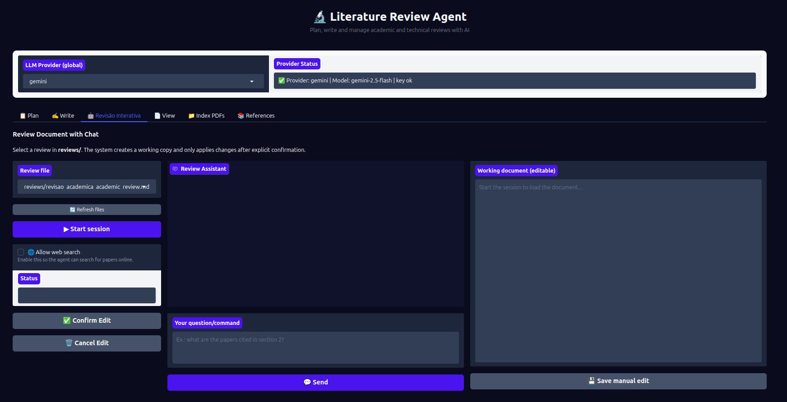

# 🤖 Aba Revisão Interativa — Edição Via Chat

## Objetivo

A aba **🤖 Revisão Interativa** permite revisar e editar documentos gerados (planos ou revisões) através de um chat com o agente. Você faz perguntas ou dá comandos em linguagem natural e o agente sugere ou aplica edições diretamente no documento.

O agente pode:
- Resumir seções, listar citações ou descrever o que o documento aborda
- Sugerir adições, reescritas ou melhorias em trechos específicos
- Buscar novas fontes na web (quando a busca web está ativada) e incorporá-las
- Aplicar edições propostas com sua aprovação explícita

---

## Campos e controles

| Campo | Tipo | Descrição |
|-------|------|-----------|
| **Arquivo de revisão** | Dropdown | Seleciona o arquivo `.md` da pasta `runtime/reviews/` para revisar |
| **Botão Atualizar** | Botão (pequeno) | Recarrega a lista de arquivos |
| **Botão Iniciar sessão** | Botão | Carrega o arquivo e inicia a sessão de revisão |
| **Busca web** | Checkbox | Ativa o Tavily para o agente buscar fontes online durante a revisão |
| **🧑‍⚖️ Journal Reviewer Mode** | Checkbox | Troca o chat para o modo revisor de periódico (relatório com notas + perguntas de acompanhamento, somente leitura) |
| **Área de preview** | Caixa de texto (editável) | Exibe o documento em formato editável — você pode editar diretamente aqui |
| **Campo de pergunta/comando** | Caixa de texto (3 linhas) | Digite sua pergunta ou instrução para o agente |
| **Botão Enviar** | Botão | Envia a mensagem para o agente |
| **Botão Confirmar edição** | Botão | Aplica a edição proposta pelo agente ao documento |
| **Botão Cancelar edição** | Botão | Descarta a edição proposta e mantém o documento atual |
| **Botão Salvar edição manual** | Botão | Salva a versão do documento que você editou manualmente no preview |
| **Status** | Campo de texto (somente leitura) | Indica o estado da sessão: `🟡 Pending edit` ou `✅ Session active` |

---

## Fluxo passo a passo

1. No dropdown **Arquivo de revisão**, selecione o `.md` que deseja revisar (da pasta `runtime/reviews/`).
   - Se não encontrar o arquivo, clique em **"🔄 Refresh files"**.
2. Opcionalmente ative **"🌐 Allow web search"** se quiser que o agente busque novas referências online.
3. Clique em **"▶ Start session"**.
   - O agente carrega o arquivo e cria uma cópia de trabalho com carimbo de data/hora (ex: `...__review_edit_20260321_1530.md`).
   - O conteúdo aparece na área de preview à direita.
4. **Digite sua pergunta ou comando** no campo de texto (exemplos abaixo) e clique em **"💬 Send"**.
5. O agente responde no chat com análise, resposta ou proposta de edição.
6. Se houver uma **edição proposta**:
   - O status muda para `🟡 Pending edit`
   - Clique em **"✅ Confirm Edit"** para aplicar ao documento
   - Ou clique em **"🗑️ Cancel Edit"** para descartar
7. Você também pode **editar o texto diretamente** no preview e clicar em **"💾 Save manual edit"** para salvar.
8. Continue enviando perguntas e confirmando edições até ficar satisfeito.

### Exemplos de comandos para o agente

```
Quais são as principais referências citadas nesta seção?
Reescreva o parágrafo de introdução deixando mais objetivo.
Adicione uma subseção sobre limitações do método.
Melhore a argumentação do terceiro parágrafo.
Pesquise artigos recentes sobre o tema e sugira como incorporá-los.
Verifique se há inconsistências entre as seções 2 e 4.
```

---



---

## Journal Reviewer Mode (revisor de periódico)

Gera um **parecer de revisor** sobre o documento aberto e permite conversar sobre ele.

**Como usar**

1. Inicie a sessão normalmente e marque **🧑‍⚖️ Journal Reviewer Mode**.
2. Envie qualquer mensagem (ex.: "Avalie este documento como revisor"). O status mostra `⏳` enquanto o relatório é gerado (alguns segundos).
3. Faça perguntas sobre o relatório (ex.: "Por que a nota de novidade é essa?", "Qual seção enfraquece mais a metodologia?").
4. Para refazer a avaliação, peça explicitamente (ex.: "gerar novamente", "refazer o relatório", "regenerate the review"); a mensagem inteira deve ser o pedido; perguntas ou pedidos com escopo (ex.: "regenerate the review of section 3") são tratados como follow-up e não regeneram nada. O relatório guarda um hash do documento em que foi gerado: se a cópia de trabalho mudar depois (por exemplo, edições feitas com o modo desligado), as respostas seguintes passam a vir com um aviso de que o relatório pode estar desatualizado e sugerem "gerar novamente". Para voltar a editar, desmarque o checkbox — o relatório guardado é mantido, então religar o modo não gera (nem cobra) outra avaliação.

**Anatomia do relatório**

| Parte | Conteúdo |
|-------|----------|
| Recomendação geral | `accept`, `minor_revision`, `major_revision` ou `reject` |
| 4 critérios | Metodologia, Contribuição, Novidade, Qualidade da escrita — cada um com nota **1–10**, pontos fortes, pontos fracos e sugestões |
| Resumo | Veredito em prosa |

Os critérios são lidos para uma **revisão de literatura** (ex.: "metodologia" = como as fontes foram escolhidas e sintetizadas), não para um artigo empírico. O relatório sai no idioma detectado na sua mensagem.

**Comportamento e limites**

- **Somente leitura:** o modo nunca altera a cópia de trabalho, nunca cria edição pendente e recusa pedidos de reescrita; desligue o modo para usar o fluxo normal de edição.
- **Notas não calibradas:** são julgamentos relativos de um LLM, não medidas; use-as para comparar rascunhos, não como veredito. O relatório traz esse aviso.
- **Documentos longos:** o texto enviado ao revisor é limitado por `JOURNAL_REVIEW_MAX_CHARS` (padrão 30000, mínimo 1000). O corte mantém as seções iniciais, mantém em parte (cortada em fronteira de parágrafo) a primeira seção que não cabe inteira — desde que ainda sobre pelo menos 20% do orçamento — e omite o resto; um marcador no texto informa quais seções foram mantidas parcialmente ou omitidas. Valores abaixo de 1000 são rejeitados na inicialização.
- **Busca web nas respostas:** nas perguntas de acompanhamento, as ferramentas de busca na web só ficam disponíveis com o checkbox **Busca web** marcado (ou pedido explícito); a geração do relatório nunca usa ferramentas.
- **Sem persistência:** o relatório vive só na sessão; reiniciar a sessão ou o app o descarta.
- Cada geração aparece no experimento MLflow `journal_review` (se o MLflow estiver indisponível, o relatório é exibido normalmente).

---

## Erros comuns e como resolver

### Dropdown de arquivos vazio
- Gere uma revisão na aba **✍️ Write** antes de usar esta aba.
- Clique em **"🔄 Refresh files"**.

### Agente não propõe edições, apenas responde no chat
- Comandos de consulta (ex: "quais são as referências?") retornam respostas sem edição — isso é esperado.
- Para edições, use comandos explícitos: "reescreva", "adicione", "melhore", "corrija".

### Status permanece `🟡 Pending edit` após confirmar
- Clique novamente em **"✅ Confirm Edit"**.
- Se persistir, use **"💾 Save manual edit"** para salvar o estado atual do preview manualmente.

### Busca web não encontra resultados
- Verifique se `TAVILY_API_KEY` está configurada no `.env`.
- Desative a busca web e tente apenas com o conteúdo local do documento.

### Edição manual não salva
- Certifique-se de clicar em **"💾 Save manual edit"** após editar o preview.
- O botão salva o conteúdo atual da área de preview, sobrescrevendo o arquivo de trabalho.
